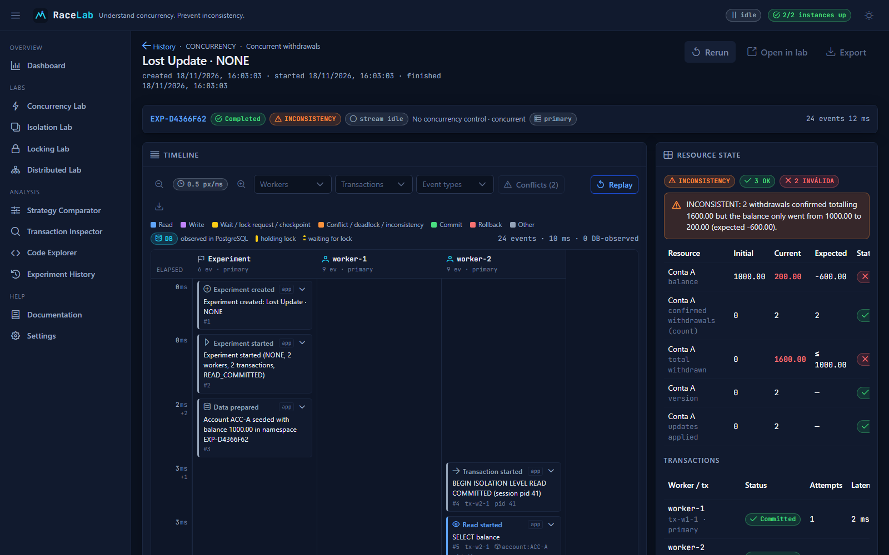
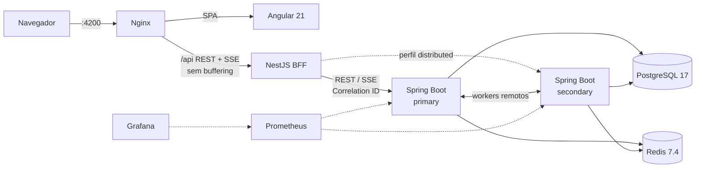
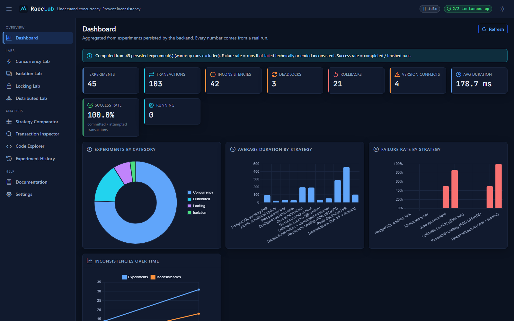
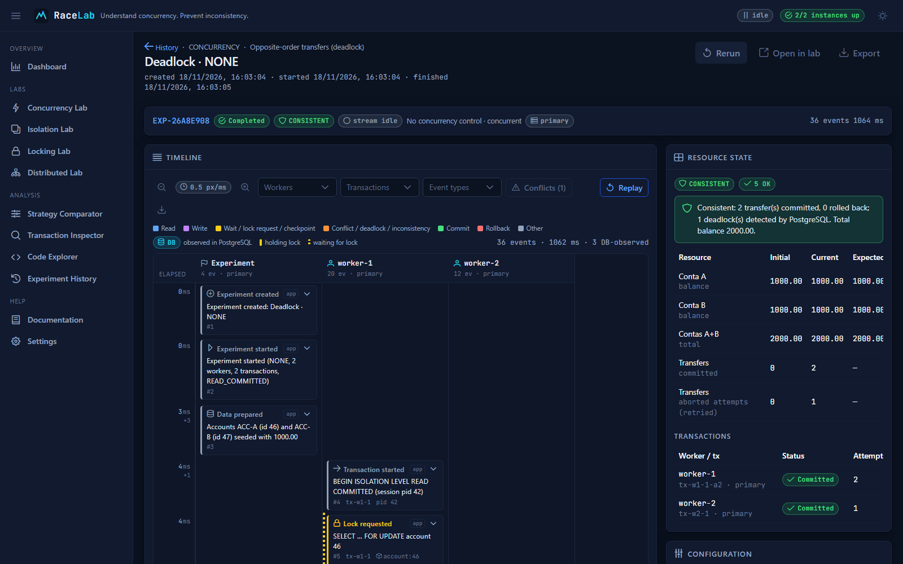
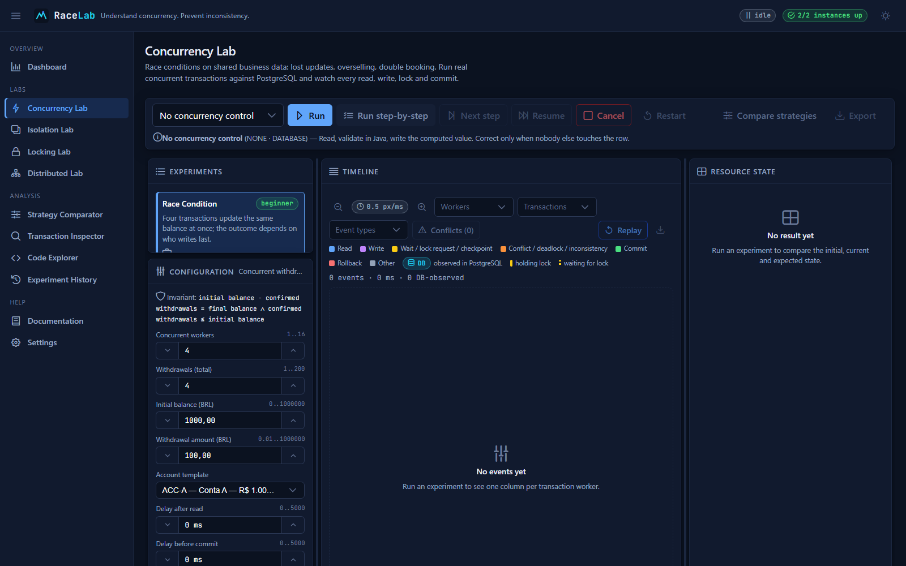
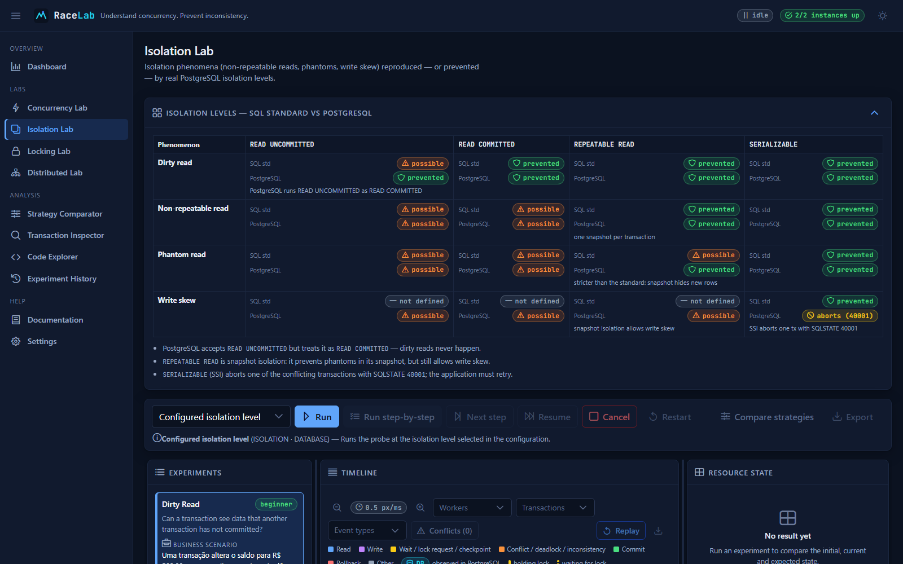
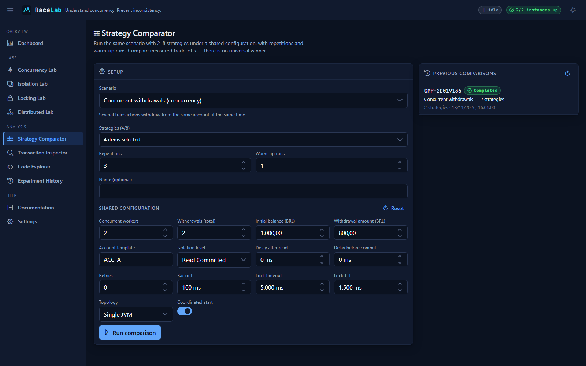
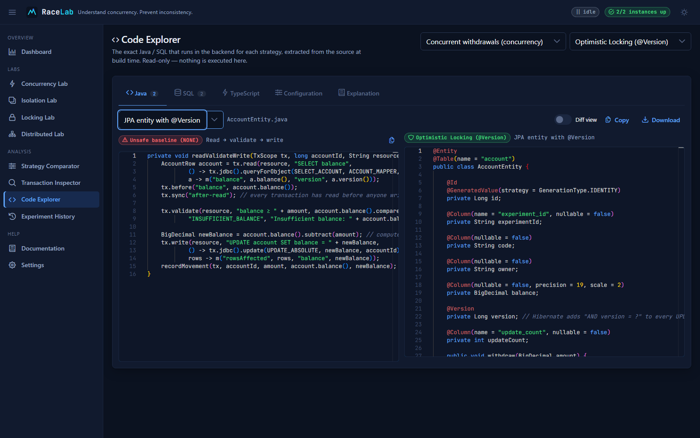
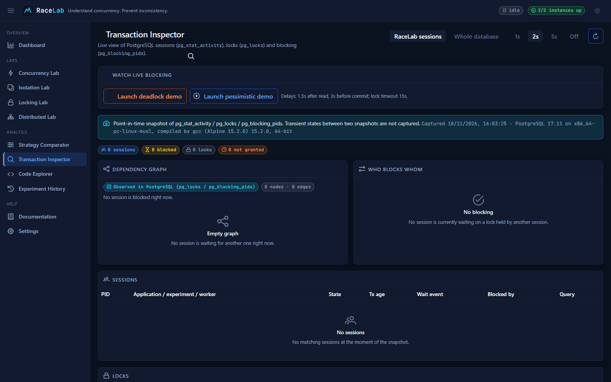

<div align="center">

# ⚡ RaceLab

### Real-Time Concurrency & Transaction Laboratory

**Understand concurrency. Prevent inconsistency.**


</div>



O RaceLab é uma plataforma para **executar, observar e corrigir** problemas reais de concorrência, isolamento
transacional e consistência de dados. Não é uma animação: cada experimento dispara **threads reais**, cada uma
com **sua própria conexão e transação no PostgreSQL**, e o resultado é calculado a partir do **estado final lido
do banco**. Deadlocks são detectados pelo PostgreSQL (`40P01`), falhas de serialização vêm do SSI (`40001`),
esperas por lock são observadas em `pg_blocking_pids` e tudo chega ao navegador, evento a evento, via SSE.

---

## Sumário

- [Por que o RaceLab existe](#por-que-o-racelab-existe)
- [Funcionalidades](#funcionalidades)
- [Arquitetura](#arquitetura)
- [Stack](#stack)
- [Início rápido](#início-rápido)
- [Portas e serviços](#portas-e-serviços)
- [Configuração](#configuração)
- [Cenários e estratégias](#cenários-e-estratégias)
- [Demonstrações passo a passo](#demonstrações-passo-a-passo)
- [Exemplos de código](#exemplos-de-código)
- [Como o motor garante experimentos reais e determinísticos](#como-o-motor-garante-experimentos-reais-e-determinísticos)
- [API](#api)
- [Testes](#testes)
- [Screenshots](#screenshots)
- [Limitações](#limitações)
- [Troubleshooting](#troubleshooting)
- [Roadmap](#roadmap)
- [Documentação adicional](#documentação-adicional)

---

## Por que o RaceLab existe

Bugs de concorrência são raros em desenvolvimento, frequentes em produção e caros quando acontecem:
saldo que não fecha, estoque vendido duas vezes, assento reservado para dois clientes, pagamento cobrado em
dobro após um retry, plantão sem médico. Eles dependem de *timing*, por isso são difíceis de reproduzir,
explicar e testar.

O RaceLab torna esses problemas **reproduzíveis de forma determinística**, mostra **o que o banco realmente
fez** e compara as estratégias de correção **com números medidos**, não com opiniões.

| Problema | O que o RaceLab demonstra |
|---|---|
| Race condition / Lost update | Duas transações leem R$ 1.000, ambas gravam R$ 200 e dois saques de R$ 800 são confirmados |
| Check-then-act | Double booking, overselling, estoque negativo |
| Deadlock | Ciclo real detectado pelo PostgreSQL, vítima revertida, grafo extraído do `DETAIL` do erro |
| Write skew | Regra "≥ 1 médico de plantão" violada sob REPEATABLE READ e preservada sob SERIALIZABLE |
| Isolamento | O que o padrão SQL permite × o que o PostgreSQL realmente faz (sem fenômenos fabricados) |
| Retry e idempotência | Timeout do cliente gera cobrança dupla; Idempotency Key devolve a resposta original |
| Locks em JVM × distribuídos | `synchronized` não protege duas JVMs; advisory lock e Redis lock protegem |
| Lease expirado | Dois donos do "mesmo" lock Redis; fencing token rejeita o dono obsoleto |
| Dual write × Outbox | Evento perdido, evento fantasma, entrega duplicada e consumidor idempotente |

## Funcionalidades

- **Dashboard** com indicadores reais (experimentos, transações, inconsistências, deadlocks, rollbacks,
  conflitos de versão, duração média, taxa de sucesso), gráficos e atalhos para as 8 demos.
  Nenhum número é fictício.
- **Labs** (Concurrency, Isolation, Locking, Distributed) com catálogo de **33 experimentos**, configuração completa
  (threads, transações, valores, delays, isolamento, timeouts, retries/backoff, seed, modo, topologia, TTL,
  falhas injetadas) validada no frontend **e** no backend.
- **Timeline em tempo real** (SSE) com uma coluna por transação, cores **e** ícones/rótulos, zoom, filtros,
  detalhes expansíveis, destaque de conflitos, eventos "observados no PostgreSQL" × "instrumentados",
  replay e exportação.
- **Modo passo a passo**: checkpoints `BEGIN → READ → VALIDATE → WRITE → COMMIT` liberados pelo usuário, com
  timeout automático que cancela e libera recursos.
- **Estado dos recursos** (Inicial | Atual | Esperado | Status), transações (tentativas, latência, espera por lock,
  SQLSTATE, mensagens técnica e amigável) e **Consistency Validator** com invariantes de negócio.
- **Grafo de locks/deadlock** reportado pelo PostgreSQL, observado ou reconstruído (sempre identificado).
- **Strategy Comparator**: mesma configuração, dados isolados e idênticos por execução, repetições e warm-up,
  tabela comparativa (p95, throughput, rollbacks, conflitos, espera por lock, consistência) e gráficos.
- **Transaction Inspector**: `pg_stat_activity`, `pg_locks`, `pg_blocking_pids` e grafo de bloqueios ao vivo.
- **Code Explorer** (Monaco): Java/SQL **extraídos do código que executa**, inseguro × corrigido lado a lado,
  diff, cópia e download.
- **Recommendations Engine** determinístico (justificativa, benefícios, trade-offs).
- **Histórico** persistente: detalhes, reexecução (novo id, dados novos), duplicação, comparação, exclusão.
- **Exportação** JSON, CSV, Markdown e PDF.
- **Distributed Lab** com **duas JVMs reais** e roteamento por instância.
- **Observabilidade**: logs estruturados, Correlation ID, Micrometer/Prometheus, Actuator, Grafana.
- Tema escuro/claro, menu recolhível, layout responsivo.

## Arquitetura



- **Angular**: interface, configuração, timeline, gráficos, comparação, código. Sem regra transacional.
- **NestJS BFF**: proxy REST e SSE sem buffering, Correlation ID, roteamento por instância
  (`X-RaceLab-Instance` / `?instance=`), timeouts, rate limiting, erros padronizados, agregação de instâncias.
  Não acessa o banco.
- **Spring Boot** (arquitetura hexagonal): motor de experimentos, estratégias (Strategy Pattern), transações,
  eventos, métricas, invariantes, recomendações, relatórios.

Detalhes em [docs/ARCHITECTURE.md](docs/ARCHITECTURE.md).

## Stack

| Camada | Tecnologias |
|---|---|
| Frontend | Angular 21 (standalone, Signals, zoneless), TypeScript 5.9, PrimeNG 21, SCSS, RxJS, Chart.js 4, Monaco Editor, EventSource (SSE), Vitest, Playwright |
| BFF | NestJS 11, TypeScript, Axios, Swagger/OpenAPI, @nestjs/throttler, Jest, Supertest |
| Backend | Java 25, Spring Boot 4.1 (Web MVC, Data JPA/Hibernate 7, JDBC, Transactions, Validation, Actuator, Data Redis), SpringDoc 3, Flyway, Maven, ExecutorService, CompletableFuture, CountDownLatch, Micrometer, OpenPDF, JUnit 5, Mockito, Testcontainers 2 |
| Infra | PostgreSQL 17, Redis 7.4 (locks + Streams), Docker, Docker Compose (profiles), Nginx, Prometheus, Grafana |

## Início rápido

### Pré-requisitos

- Docker 24+ com Docker Compose v2 (BuildKit).
- ~4 GB de RAM livres para a stack.
- Para desenvolver ou rodar testes fora do Docker: Java 25, Node.js 24.

### Subir a aplicação

```bash
git clone <repo> racelab && cd racelab
cp .env.example .env            # opcional: credenciais locais de demonstração
docker compose up --build -d
```

Abra **http://localhost:4200**. O banco é criado, migrado (Flyway) e populado com os templates
(contas, produtos, assentos, médicos, pedidos), e a aplicação já pode ser usada.

```bash
# duas JVMs independentes (Distributed Lab / Demo 6)
docker compose --profile distributed up --build -d

# Prometheus + Grafana
docker compose --profile observability up --build -d

# tudo
docker compose --profile distributed --profile observability up --build -d

# parar (os dados persistem no volume racelab-pgdata)
docker compose down          # ou: docker compose down -v para apagar os dados
```

### Desenvolvimento local (sem Docker para as aplicações)

```bash
docker compose up -d racelab-postgres racelab-redis           # apenas a infraestrutura*
cd backend  && ./mvnw spring-boot:run                          # :8080
cd bff      && npm ci && npm run start:dev                     # :3000
cd frontend && npm ci && npm start                             # :4200 (proxy /api → :3000)
```

\* O PostgreSQL não publica porta por segurança. Para desenvolvimento local, adicione temporariamente
`ports: ["127.0.0.1:5432:5432"]` ao serviço ou use um PostgreSQL local (variáveis `RACELAB_DB_*`).

## Portas e serviços

| Serviço | URL | Exposição |
|---|---|---|
| Frontend (Nginx) | http://localhost:4200 | pública (host) |
| BFF + Swagger do BFF | http://localhost:3000/bff/docs | 127.0.0.1 |
| Backend primary + Swagger | http://localhost:8080/api/swagger-ui.html | 127.0.0.1 |
| Backend secondary (perfil `distributed`) | http://localhost:8081 | 127.0.0.1 |
| Prometheus (perfil `observability`) | http://localhost:9090 | 127.0.0.1 |
| Grafana (perfil `observability`) | http://localhost:3001 (admin / racelab) | 127.0.0.1 |
| PostgreSQL / Redis | — | apenas rede interna do Docker |

Acesse o banco com `docker compose exec racelab-postgres psql -U racelab_owner racelab`.

## Configuração

Variáveis em [.env.example](.env.example):

| Variável | Padrão | Descrição |
|---|---|---|
| `POSTGRES_USER` / `POSTGRES_PASSWORD` | `racelab_owner` / `racelab_owner_local` | dono do schema (usado só pelo Flyway) |
| `RACELAB_APP_PASSWORD` | `racelab_app_local` | papel de runtime `racelab_app` (DML apenas) |
| `RACELAB_INTERNAL_TOKEN` | `change-me-local-internal-token` | token do protocolo entre instâncias |
| `RACELAB_MAX_CONCURRENT_EXPERIMENTS` | `3` | experimentos simultâneos por instância (409 acima) |
| `RACELAB_DB_POOL_SIZE` | `60` | pool Hikari |
| `BFF_TIMEOUT_MS` | `15000` | timeout REST do BFF (SSE não tem timeout) |
| `BFF_RATE_LIMIT_PER_MINUTE` | `600` | rate limiting do BFF por cliente |
| `FRONTEND_PORT`, `BFF_PORT`, `BACKEND_PORT`, … | ver arquivo | portas publicadas |

Limites de experimento (validados no frontend e no backend): threads 1–16, transações 1–200, recursos 1–20,
delays 0–5000 ms, timeout de transação 1–60 s, `lock_timeout` 0,1–30 s, retries 0–10, TTL de lock 0,2–30 s,
timeout do passo a passo 10–600 s.

## Cenários e estratégias

| Cenário | Estratégias disponíveis |
|---|---|
| Conta bancária (`bank-withdrawal`) | Sem controle · Optimistic (`@Version`) · Pessimistic (`@Lock(PESSIMISTIC_WRITE)`) · Atomic Update · Serializable · `synchronized` · `ReentrantLock` · Advisory Lock · Redis Lock, em uma ou **duas JVMs** |
| Estoque (`inventory`) | Sem controle · Atômico sem guarda · Optimistic (JDBC) · Pessimistic · Atomic Update · Serializable |
| Reserva de assentos (`seat-reservation`) | Sem controle · Unique Constraint · Pessimistic · Atomic Update |
| Pagamento duplicado (`duplicate-payment`) | Sem controle · Unique Constraint · Idempotency Key |
| Deadlock (`deadlock`) | Ordem inversa · Ordenação consistente dos locks (+ retry limitado) |
| Write skew (`write-skew`) | Isolamento configurável · Serializable · `FOR UPDATE` · Advisory Lock |
| Processamento de pedidos (`order-processing`) | Sem controle · Claim atômico · `SKIP LOCKED` · Consumidor idempotente |
| Isolamento (`dirty-read`, `non-repeatable-read`, `phantom-read`, `isolation-probe`) | READ UNCOMMITTED · READ COMMITTED · REPEATABLE READ · SERIALIZABLE |
| Expiração de lock (`lock-expiration`) | Redis Lock · Redis Lock + Fencing Token |
| Outbox (`outbox`) | Dual write · Outbox + consumidor idempotente · Outbox + consumidor ingênuo, com falhas injetadas |

Catálogo completo e resultados medidos: [docs/EXPERIMENTS.md](docs/EXPERIMENTS.md).

## Demonstrações passo a passo

As 8 demos aparecem como atalhos no Dashboard. Os resultados abaixo foram **medidos** nesta stack.

### Demo 1 — Detectando Lost Update
1. Dashboard → **Demo 1** (ou Concurrency Lab → *Lost Update*).
2. Conta A com R$ 1.000, 2 workers, saque de R$ 800, estratégia *No concurrency control*.
3. **Executar**. Na timeline os dois `READ 1000.00` acontecem antes de qualquer `WRITE`. O segundo `UPDATE`
   espera o commit do primeiro e então sobrescreve o saldo.
4. Resultado: 2 saques confirmados (R$ 1.600), saldo R$ 200, **esperado −R$ 600 → INVÁLIDA**.
   As recomendações sugerem atomic update, optimistic e pessimistic locking.

### Demo 2 — Corrigindo Lost Update
1. Mesmo cenário com **Optimistic Locking**.
2. O Hibernate executa `UPDATE … WHERE version = 0`; o perdedor afeta 0 linhas → `OPTIMISTIC_LOCK_CONFLICT` e rollback.
3. Com `retries = 1`, o perdedor relê R$ 200 em nova transação e é rejeitado pela regra de negócio. Consistente.

### Demo 3 — Deadlock real
1. Demo 3: transação A bloqueia a conta 1 e depois a 2; a transação B faz o inverso.
2. Após `deadlock_timeout`, o PostgreSQL aborta uma delas com **SQLSTATE 40P01** (`DEADLOCK_DETECTED`, origem *observed in DB*).
3. A aba **Lock Graph** mostra o ciclo extraído do `DETAIL` do erro, com a vítima destacada. O retry limitado conclui a transferência.
4. Troque para **LOCK_ORDERING** e o deadlock desaparece.

### Demo 4 — Estoque concorrente
1. Estoque 10, duas compras de 7. *No control*: 14 unidades vendidas e estoque 3 (lost update + overselling).
2. *Atomic without guard*: estoque **−4**.
3. *Atomic Update* (`WHERE stock >= :qty`): uma compra rejeitada, estoque 3, consistente.
   Use **Comparar estratégias** para ver as três lado a lado.

### Demo 5 — Idempotência
1. A primeira requisição grava o pagamento; antes do commit o cliente sofre timeout e tenta de novo com a mesma chave.
2. O retry executa `INSERT … ON CONFLICT DO NOTHING` e **espera no índice único** (espera visível como `LOCK_WAITING` observado no PostgreSQL).
3. Ao commit da original, o retry lê o registro e recebe **a resposta original**: um único pagamento.
   Compare com *Retry with duplication risk* (cobrança dupla).

### Demo 6 — JVMs independentes
1. `docker compose --profile distributed up -d`. O cabeçalho mostra **2/2 instances up**.
2. Distributed Lab → *Independent JVMs and synchronized*: o worker-1 roda no **primary** e o worker-2 no **secondary**.
3. Resultado: **lost update** (cada JVM tem seu monitor). Troque para *Advisory Lock*, *Pessimistic*, *Atomic Update* ou *Redis Lock*: consistente.

### Demo 7 — Write Skew
1. Dois médicos de plantão; cada transação vê "2 disponíveis" e desativa um médico **diferente**.
2. REPEATABLE READ: ambos confirmam e **ninguém fica de plantão**.
3. SERIALIZABLE: o PostgreSQL aborta uma com **40001** e a regra é preservada.

### Demo 8 — Outbox
1. Pedidos e eventos gravados na mesma transação; o relay publica no Redis Streams e **cai depois de publicar e antes de marcar PUBLISHED** (`FAULT_INJECTED`).
2. O evento continua pendente e é republicado: 4 entregas para 3 pedidos.
3. O consumidor idempotente (`processed_event` com `UNIQUE`) gera **3 faturas**. Compare com *Partial failure* (dual write: pedido sem evento) e *Duplicate events* (consumidor ingênuo: fatura duplicada).

## Exemplos de código

O Code Explorer mostra trechos **extraídos do código-fonte que roda**. Marcadores
`// @snippet:start … // @snippet:end` são lidos do JAR. Alguns exemplos:

**Inseguro: read → validate → write** (`BankWithdrawalExperiment.java`)
```java
AccountRow account = tx.read(resource, "SELECT balance",
        () -> tx.jdbc().queryForObject(SELECT_ACCOUNT, ACCOUNT_MAPPER, accountId), …);
tx.sync("after-read"); // every transaction has read before anyone writes
tx.validate(resource, "balance ≥ " + amount, account.balance().compareTo(amount) >= 0, …);
BigDecimal newBalance = account.balance().subtract(amount); // computed from a possibly stale read
tx.write(resource, "UPDATE account SET balance = " + newBalance,
        () -> tx.jdbc().update(UPDATE_ABSOLUTE, newBalance, accountId), …);
```

**Corrigido: atualização atômica condicional**
```sql
UPDATE account
   SET balance = balance - ?, version = version + 1, update_count = update_count + 1
 WHERE id = ?
   AND balance >= ?
```
```java
int updated = tx.write(resource, "UPDATE … WHERE balance >= " + amount,
        () -> tx.jdbc().update(WITHDRAW_ATOMIC, amount, accountId, amount), …);
tx.validate(resource, "rows affected = 1", updated == 1, "INSUFFICIENT_BALANCE", …);
recordMovement(tx, accountId, amount, after.add(amount), after); // same transaction
```

**Optimistic locking**
```java
@Version
private Long version; // Hibernate adds "AND version = ?" to every UPDATE and increments it
```

**Pessimistic locking**
```java
@Lock(LockModeType.PESSIMISTIC_WRITE)
@Query("select a from AccountEntity a where a.id = :id")
Optional<AccountEntity> findByIdForUpdate(@Param("id") Long id);
```

**Redis: liberação segura**
```lua
if redis.call('get', KEYS[1]) == ARGV[1] then return redis.call('del', KEYS[1]) else return 0 end
```

**Fencing token**
```sql
UPDATE account SET balance = ?, last_fencing_token = ?, …
 WHERE id = ? AND last_fencing_token < ?
```

## Como o motor garante experimentos reais e determinísticos

```java
public interface Experiment {
    ScenarioDescriptor descriptor();
    ScenarioReport execute(ExperimentConfiguration configuration, ExperimentContext context);
}
```

- **Transações reais e independentes**: cada worker é uma thread de um `ExecutorService`. Cada operação usa
  `PlatformTransactionManager` (`REQUIRES_NEW`), com conexão e `EntityManager` ligados à thread e nunca
  compartilhados. Não há armadilhas de self-invocation. O `COMMIT` e o `ROLLBACK` são explícitos.
- **Timeouts em todas as camadas**: `SET LOCAL lock_timeout`, `statement_timeout` e
  `idle_in_transaction_session_timeout`, timeout da transação Spring, do rendezvous e do passo a passo, e
  timeout global de 10 minutos.
- **Interleaving determinístico**: um `CountDownLatch` faz a largada simultânea. Um **Rendezvous** consciente
  de locks libera o ponto crítico quando cada participante chegou, terminou ou está **realmente bloqueado**.
  O bloqueio é confirmado pelo PostgreSQL via `pg_blocking_pids`. Um `CyclicBarrier` puro travaria com
  locking pessimista, e `Thread.sleep` não é usado como mecanismo de sincronização.
- **Nada simulado do lado do banco**: 40P01, 40001, 23505, 55P03 e conflitos de versão vêm do PostgreSQL ou do
  Hibernate. Crashes de processo (outbox) são falhas injetadas rotuladas `FAULT_INJECTED`.
- **Eventos à prova de rollback**: o log de eventos é gravado por outra thread e outras conexões, então eventos
  de transações revertidas permanecem.
- **Dados isolados**: cada experimento copia templates para seu próprio namespace (`experiment_id`), e
  experimentos simultâneos e reexecuções nunca compartilham linhas.
- **Cancelamento cooperativo**: o token é checado em cada checkpoint, e `pg_cancel_backend` libera
  sessões presas em locks.

## API

Documentada via OpenAPI em **http://localhost:8080/api/swagger-ui.html** (backend) e
**http://localhost:3000/bff/docs** (BFF). O contrato completo está em [docs/API-CONTRACT.md](docs/API-CONTRACT.md).

```
GET  /api/scenarios · /api/scenarios/{id} · /api/catalog · /api/strategies
POST /api/experiments                         GET /api/experiments · /api/experiments/{id}
POST /api/experiments/{id}/start|step|resume|cancel|rerun
GET  /api/experiments/{id}/events            (SSE com Last-Event-ID, ou JSON)
GET  /api/experiments/{id}/result|metrics|transactions|violations|recommendations
GET  /api/experiments/{id}/export?format=json|csv|markdown|pdf
DELETE /api/experiments/{id}
POST /api/comparisons · GET /api/comparisons · /api/comparisons/{id} · POST /api/comparisons/{id}/cancel
GET  /api/code-examples/{scenario}/{strategy}
GET  /api/dashboard · /api/inspector/snapshot · /api/system/info · /api/instances (BFF)
```

Erros seguem um formato único: `{timestamp, status, error, code, message, details, correlationId, path}`.

## Testes

| Módulo | Comando | Resultado |
|---|---|---|
| Backend (unitários + integração com **PostgreSQL 17 e Redis reais** via Testcontainers) | `cd backend && ./mvnw test` | 44 ✔ |
| BFF (proxy REST/SSE, correlation id, reconexão, cancelamento, erros) | `cd bff && npm test` | 10 ✔ |
| Frontend (configuração, timeline, SSE/deduplicação, comparador, resultado, cancelamento) | `cd frontend && npm test` | 55 ✔ |
| E2E Playwright (stack rodando) | `cd frontend && npx playwright install chromium && npm run e2e` | 6 ✔ |
| Smoke da stack (8 demos, SSE via Nginx, exports) | `node examples/smoke.mjs` | ✔ |
| Matriz distribuída (duas JVMs) | `node examples/distributed.mjs` | ✔ |

H2 nunca é usado: semântica de concorrência e isolamento depende do banco. Detalhes em [docs/TESTING.md](docs/TESTING.md).

## Screenshots

Capturas reais da aplicação rodando (geradas por `frontend/e2e/screenshots.ts`):

| | |
|---|---|
|  **Dashboard** |  **Deadlock real (40P01)** |
|  **Concurrency Lab** |  **Isolation Lab** |
|  **Strategy Comparator** |  **Code Explorer** |
|  **Transaction Inspector** |  **Lost update** |

## Limitações

- **Laboratório local, sem autenticação.** Não exponha publicamente sem autenticação, TLS e controles adicionais.
- Os resultados de desempenho dependem de hardware, configuração do banco, carga e cenário. O comparador **não**
  elege uma estratégia universalmente superior.
- O Transaction Inspector é uma fotografia pontual. Estados transitórios entre duas leituras não são capturados.
  O grafo de espera de cada experimento é amostrado a cada ~15–25 ms.
- Grafos de deadlock vêm do `DETAIL` do erro do PostgreSQL. Quando não há deadlock, o grafo é **reconstruído** a
  partir das esperas observadas, e isso é sempre indicado.
- Apenas a primeira "onda" de operações é coordenada pelo rendezvous. As demais rodam livremente, gerando
  contenção natural.
- O modo distribuído suporta o cenário `bank-withdrawal`, com workers alternados entre duas instâncias. A
  coordenação passa pelo orquestrador via HTTP interno.
- O fenômeno *Dirty Read* nunca é reproduzido no PostgreSQL. Isso é o comportamento correto, e não uma limitação
  do RaceLab.
- O modo passo a passo está disponível nos cenários bancário, estoque, assentos, deadlock e write skew. As sondas
  de isolamento já têm ordem fixa.
- Não há testes de carga, e os testes do modo distribuído foram feitos via scripts contra a stack (não no CI).

## Troubleshooting

| Sintoma | Causa provável e solução |
|---|---|
| Build Docker falha com `PKIX path building failed` / `self-signed certificate in certificate chain` | Proxy corporativo ou antivírus inspecionando TLS. Coloque o certificado raiz (PEM) em `infrastructure/certs/*.crt` (ver [README](infrastructure/certs/README.md)) e refaça o build. |
| `ports are not available … 4200/3000/8080` | Porta ocupada: altere `FRONTEND_PORT`, `BFF_PORT` ou `BACKEND_PORT` no `.env`. |
| Distributed Lab responde `503 PEER_UNAVAILABLE` | Suba o perfil: `docker compose --profile distributed up -d`. |
| Estratégias Redis respondem `503 REDIS_UNAVAILABLE` | Verifique `docker compose ps racelab-redis`. |
| `409 TOO_MANY_EXPERIMENTS` | Limite de experimentos simultâneos. Aguarde ou aumente `RACELAB_MAX_CONCURRENT_EXPERIMENTS`. |
| Timeline não atualiza | Confira se o stream SSE não passa por outro proxy com buffering. O Nginx já usa `proxy_buffering off`, e o cliente reconecta com `Last-Event-ID`. |
| Testes do backend falham ao iniciar | Docker precisa estar em execução (Testcontainers). |
| Após mudar credenciais no `.env` o backend não conecta | O script de papéis roda só na primeira inicialização: `docker compose down -v` recria o volume. |
| Logs | `docker compose logs -f racelab-backend` (JSON com `correlationId`, `experimentId`, `transactionId`). |

## Roadmap

- [ ] Autenticação (OIDC) e multi-tenant para uso compartilhado.
- [ ] Topologia distribuída para mais cenários (estoque, pagamentos).
- [ ] Captura contínua de `pg_locks` com timeline de locks por linha (tuple/transactionid).
- [ ] Estratégias adicionais: `SELECT … FOR SHARE`, `NOWAIT`, leases com renovação, Redlock.
- [ ] Testes de carga (k6) e relatórios de throughput sob contenção.
- [ ] Suporte a MySQL/InnoDB para comparar semânticas de isolamento entre bancos.
- [ ] Exportar a timeline como vídeo/GIF.

## Documentação adicional

- [docs/ARCHITECTURE.md](docs/ARCHITECTURE.md): camadas, motor, coordenação, SSE, segurança, observabilidade
- [docs/EXPERIMENTS.md](docs/EXPERIMENTS.md): cenários, catálogo, resultados medidos, como adicionar um cenário
- [docs/TRANSACTION-ISOLATION.md](docs/TRANSACTION-ISOLATION.md): padrão SQL × PostgreSQL
- [docs/DISTRIBUTED-LOCKING.md](docs/DISTRIBUTED-LOCKING.md): JVMs, Redis, fencing tokens, idempotência, outbox
- [docs/TESTING.md](docs/TESTING.md): estratégia e cobertura de testes
- [docs/API-CONTRACT.md](docs/API-CONTRACT.md): contrato REST/SSE

## Licença

[MIT](LICENSE)
