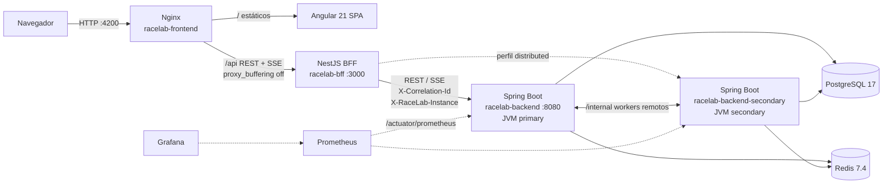
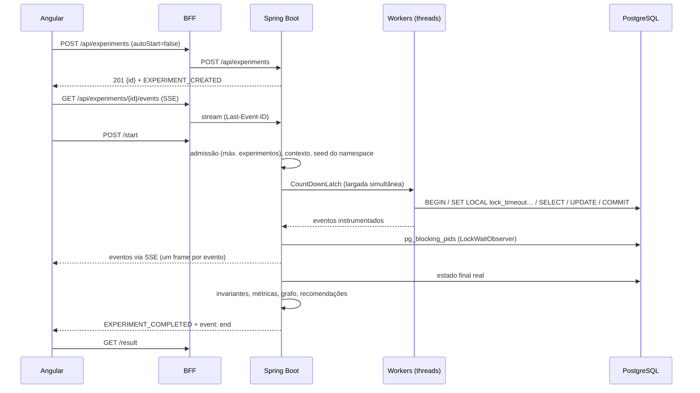

# Arquitetura do RaceLab

## Visão geral



| Camada | Responsabilidade | Não faz |
|---|---|---|
| **Angular** | Configuração, timeline em tempo real (SSE), gráficos, comparação, Monaco, inspeção | Nenhuma regra transacional |
| **NestJS BFF** | Proxy REST e SSE sem buffering, Correlation ID, roteamento por instância, timeouts, rate limiting, erros padronizados, agregação (`/api/instances`) | Não acessa o PostgreSQL nem implementa regras |
| **Spring Boot** | Motor de experimentos, transações reais, estratégias, eventos, métricas, validação de invariantes, recomendações, relatórios | — |
| **PostgreSQL 17** | Dados de negócio isolados por experimento, histórico, eventos | — |
| **Redis** | Locks distribuídos (lease + fencing counter) e Redis Streams (outbox) | — |

## Backend — arquitetura hexagonal

```
dev.racelab
├── domain
│   ├── model        Records/enums imutáveis: ExperimentConfiguration, ExperimentEvent, TransactionOutcome,
│   │                ExperimentResult, Violation, Observation, Metrics, LockGraph, ScenarioDescriptor…
│   └── port         EventStore, ExperimentRepository (portas de saída)
├── application
│   ├── engine       Motor: Experiment (SPI), ExperimentRegistry, ExperimentExecutor, ExperimentContext,
│   │                ExperimentEventPublisher/LiveEventBus, ExperimentMetricsCollector,
│   │                ExperimentCancellationManager, TransactionCoordinator, TxScope, TxGuard,
│   │                Rendezvous, StepController, BlockRegistry, LockWaitObserver, SqlErrorClassifier,
│   │                ConsistencyValidator/Invariant, StrategyRegistry, LockGraphBuilder
│   ├── port         DistributedLockService, MessageBroker, RemoteWorkerGateway
│   ├── catalog      PresetCatalog (33 experimentos + 8 demos)
│   ├── recommendation RecommendationEngine (regras determinísticas)
│   └── service      ExperimentService, ComparisonService, CodeExampleService, ExportService,
│                    InspectorService, DashboardService, EnvironmentInfo
├── scenario         Adaptadores de cenário (um Experiment por cenário) — o código exibido no Code Explorer
│   ├── bank / inventory / seat / payment / deadlock / writeskew / orders
│   ├── isolation    sondas de leitura (dirty / non-repeatable / phantom)
│   ├── distributed  lock-expiration, outbox
│   └── support      ScenarioSupport, ConfigBuilder, LockGuards (synchronized, ReentrantLock, Redis)
└── infrastructure
    ├── persistence  JdbcEventStore (escrita assíncrona), JdbcExperimentRepository
    ├── redis        RedisDistributedLockService, RoutingMessageBroker (Redis Streams / memória)
    ├── remote       HttpRemoteWorkerGateway, RemoteWorkerRuntime, InternalController
    ├── web          Controllers REST, SSE (EventStreamService), GlobalExceptionHandler, RequestGuardFilter
    └── config       Clock, OpenAPI, scheduling
```

O domínio e o motor não conhecem HTTP, Redis ou a JVM remota: dependem apenas de portas. Novos cenários são
novos beans `Experiment`; novas estratégias são novos ramos (Strategy Pattern) ou novos `TxGuard`.

## Ciclo de vida de um experimento



### Transações e threads

* Cada worker roda em sua **própria thread** de um `ExecutorService` criado por experimento.
* Cada operação usa `PlatformTransactionManager` programaticamente (`PROPAGATION_REQUIRES_NEW`): conexão e
  `EntityManager` ligados à thread — nada é compartilhado entre threads; sem armadilhas de self-invocation de
  `@Transactional`. `COMMIT_*` e `ROLLBACK_*` são emitidos exatamente ao redor de `commit()`/`rollback()`.
* No início de cada transação: `set_config('lock_timeout'|'statement_timeout'|'idle_in_transaction_session_timeout'|'application_name', …, true)`
  — escopo local à transação. O `application_name` (`racelab:<experimento>:<worker>`) permite ao Inspector
  associar sessões a workers.
* Retries limitados com backoff exponencial, sempre em **nova** transação, apenas para erros reprocessáveis
  (40P01, 40001, conflito de versão, 55P03).

### Coordenação determinística (sem `Thread.sleep` como mecanismo)

| Mecanismo | Uso |
|---|---|
| `CountDownLatch` | largada simultânea de todos os workers locais; coreografias (pagamento, outbox, lock-expiration) |
| `Rendezvous` | ponto crítico ("todos leram antes de alguém escrever"). Libera quando cada participante **chegou**, **terminou** ou está **realmente bloqueado** num lock. Um `CyclicBarrier` puro travaria em estratégias pessimistas. |
| `BlockRegistry` + `LockWaitObserver` | o worker declara uma possível espera; o observador confirma via `pg_blocking_pids` + `pg_stat_activity.wait_event` (fonte `DATABASE_OBSERVED`). Esperas em JVM/Redis são conhecidas pelo código; monitores `synchronized` só contam se persistirem > 250 ms. |
| `TurnSequencer` | ordem estrita para sondas de isolamento (leituras MVCC nunca bloqueiam) |
| `StepController` | modo passo a passo: checkpoints `begin/read/validate/write/commit`; timeout de inatividade cancela o experimento |

Delays configuráveis existem apenas para alargar janelas e tornar a timeline legível.

### Cancelamento

`ExperimentCancellationManager` levanta o token (checado em checkpoints, rendezvous e pausas) e executa
`pg_cancel_backend` nas sessões registradas do experimento — um worker bloqueado num lock é liberado na hora,
sua transação é revertida (SQLSTATE 57014 classificado como `CANCELLED`). Workers, observador e pools são
encerrados em `finally`.

### Eventos e SSE

* `LiveEventBus`: sequência atribuída sob monitor (ordem total), replay + inscrição atômicos.
* `JdbcEventStore`: thread própria grava em lote com conexões próprias → **eventos de transações revertidas
  nunca se perdem**.
* SSE: `id: <sequence>`, `event: experiment-event`, `heartbeat` a cada 15 s, `end` no final; `Last-Event-ID`
  (ou `?lastEventId=`) faz replay. Se o experimento roda em outra instância, o stream segue o log durável.
* BFF e Nginx repassam bytes sem buffering (`proxy_buffering off`, `X-Accel-Buffering: no`).

### Isolamento de dados

Toda tabela de negócio tem `experiment_id`. Linhas `TEMPLATE` (seed do Flyway) são copiadas para o namespace
do experimento no início. Experimentos simultâneos e reexecuções nunca compartilham linhas; exclusão remove
o namespace com `DELETE … WHERE experiment_id = ?` — nunca `TRUNCATE`.

### Topologia distribuída (duas JVMs)

O orquestrador (instância que recebeu o experimento) executa workers ímpares na **outra JVM** via
`POST /internal/workers/execute`. O worker remoto usa `RemoteWorkerRuntime`: eventos, checkpoints,
rendezvous, bloqueios e PIDs voltam por HTTP ao orquestrador, mantendo timeline, coordenação e cancelamento
globais — enquanto `synchronized`/`ReentrantLock` são genuinamente locais à JVM onde rodam.
O protocolo `/internal/**` exige token compartilhado e não é exposto pelo BFF/Nginx.

## Segurança e proteção de recursos

* Sem autenticação (laboratório local). **Não exponha publicamente.**
* PostgreSQL e Redis não publicam portas; backend/BFF/Prometheus/Grafana escutam só em `127.0.0.1`.
* Papel `racelab_app` com DML apenas (sem DDL/TRUNCATE); Flyway usa o dono do schema.
* Nenhum SQL/Java arbitrário é executado — o Code Explorer é somente leitura.
* Validação de parâmetros no frontend e no backend (Bean Validation), limites de threads/transações,
  máximo de experimentos simultâneos (409), payload ≤ 64 KB, rate limiting (backend e BFF), pool Hikari
  dimensionado, timeouts em todos os níveis, logs estruturados sem payloads.

## Observabilidade

* Logs estruturados (perfil `docker`: formato logstash JSON) com `experimentId`, `transactionId`, `workerId`,
  `correlationId` (MDC).
* Micrometer/Prometheus: `racelab_experiments_active`, `racelab_experiments_finished_total{scenario,strategy,status,consistent}`,
  `racelab_experiment_duration_seconds`, métricas Hikari, JVM e HTTP.
* Actuator: `/actuator/health` (readiness = DB), `/actuator/prometheus`; `/api/system/info` mostra o pool.
* Perfil `observability`: Prometheus + Grafana com dashboard provisionado.
